

  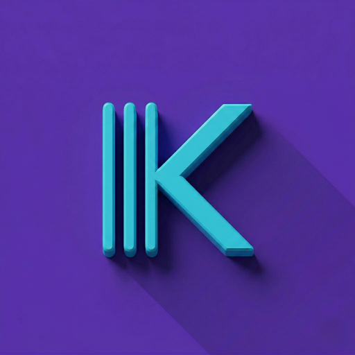
  <h1>Kioskeo</h1>
  
<b>Your shop in your pocket</b>

   
  

 

  <a href="README.md">🇦🇷 Español</a> | <b>🇺🇸 English</b> | <a href="README-pt.md">🇧🇷 Português</a>

 

A point of sale (POS) for convenience stores, corner shops and small businesses, using just the phone you already have: your register, stock, prices, customers and daily closing. No hardware, no installers, no endless subscriptions. It works 100% offline and everything stays on your phone.

---

## 🔥 NEW IN THIS VERSION (v1.15.0)

- **Your shop on the computer:** in More → Use on your computer, open Kioskeo in the browser of a computer on your Wi-Fi. See the cart, products, register and reports on a big screen; with PRO you can also sell, charge and edit from there.
- **Your phone as the barcode reader:** with the computer open, tap “Use the phone as the reader”: scan one barcode after another and each product shows up on the computer instantly.
- **With PRO: print, and your name up top:** from the computer, print each sale's receipt, the closings and the reports on your receipt printer. And tap the pencil at the top so it shows your kiosk's name instead of Kioskeo.

### In v1.14.45: everything free
- **No locks:** unlimited sales and customers, store credit, PDF closings, employees with PIN and automatic backups, for everyone.
- **Full prices** on the quick-access buttons of the sales screen.

👉 **[See the full change history (Changelog, in Spanish)](CHANGELOG.md)**

---

## 📸 SCREENSHOTS

  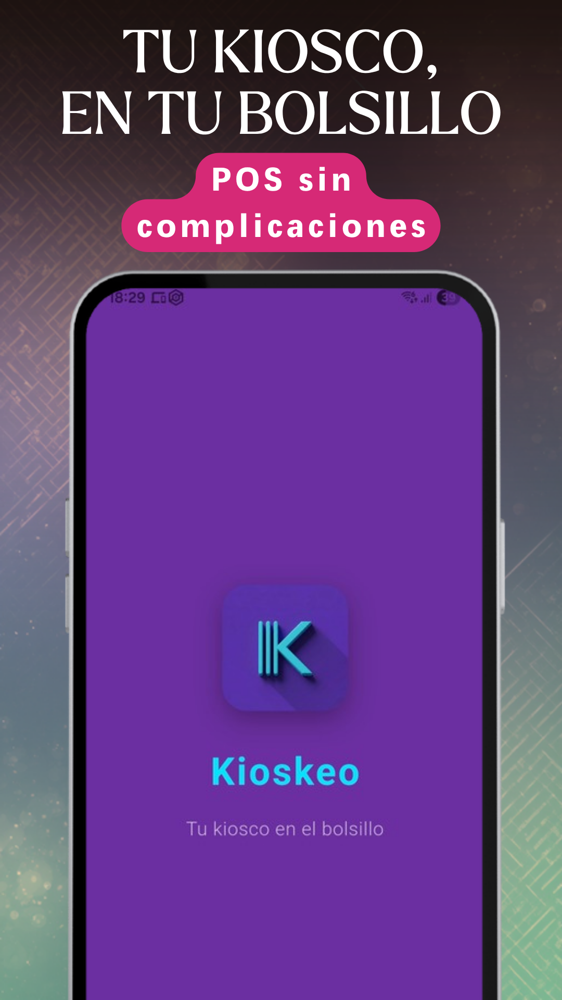
  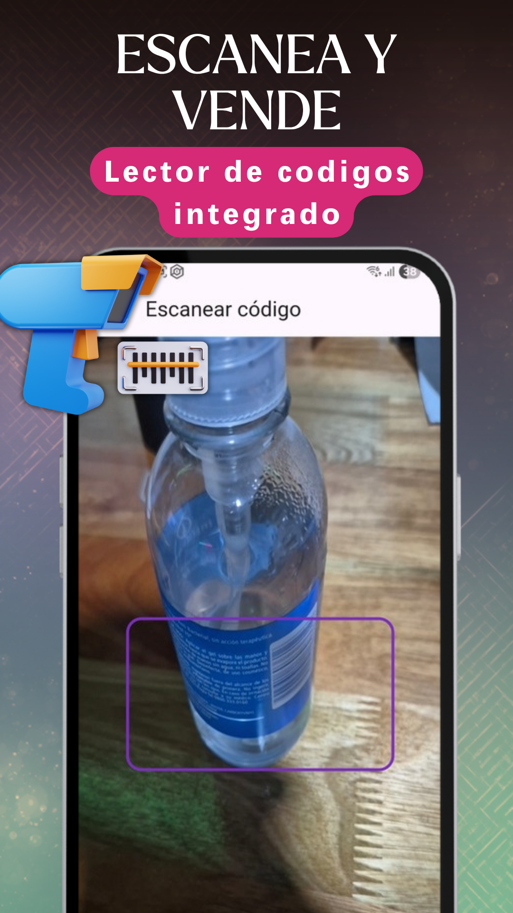
  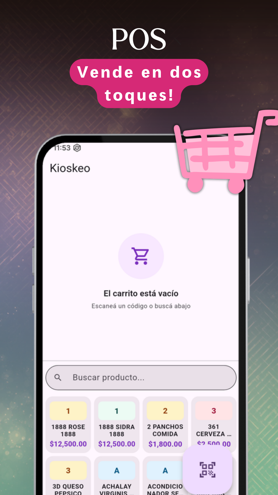
  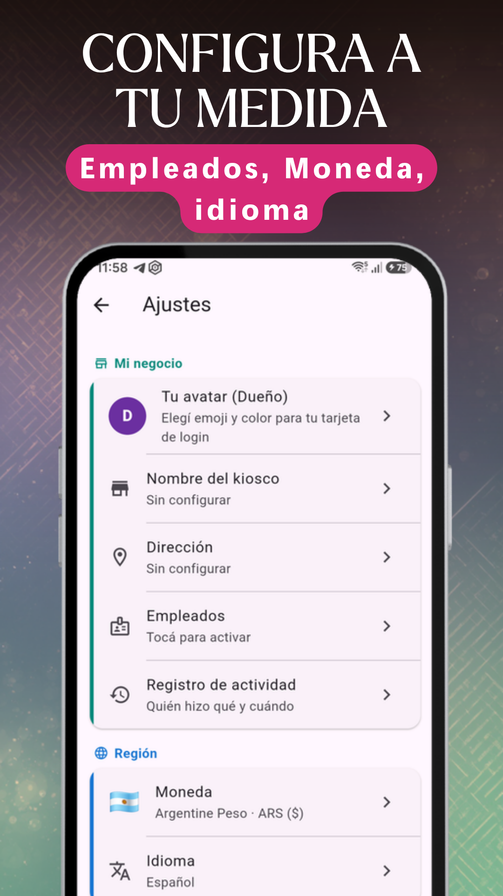

  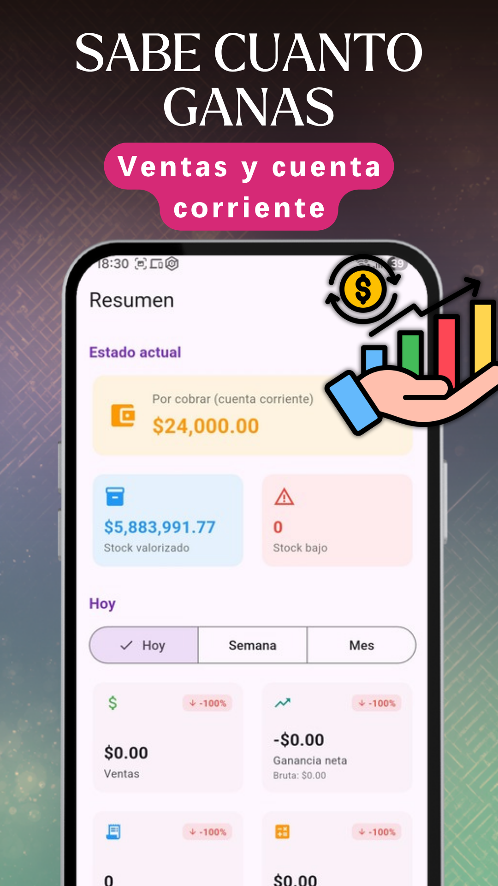
  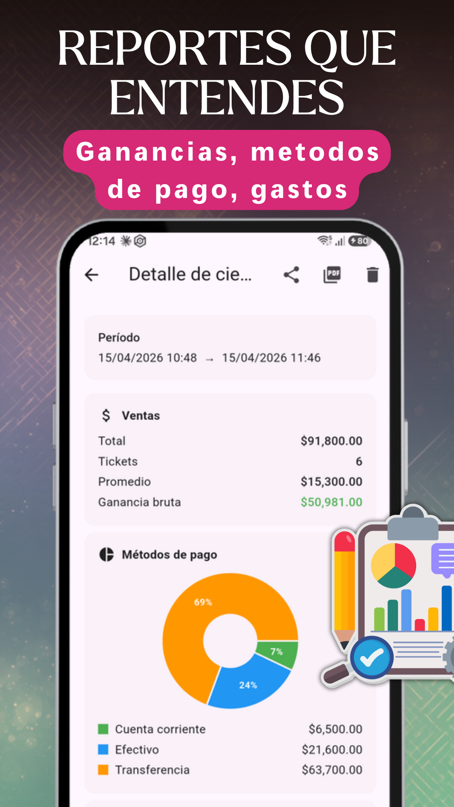
  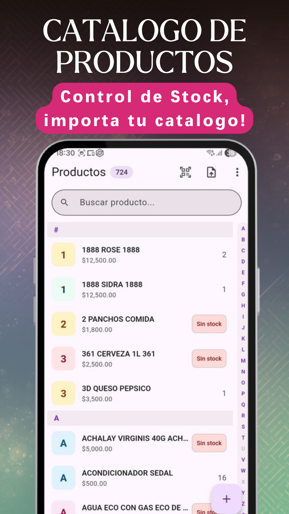
  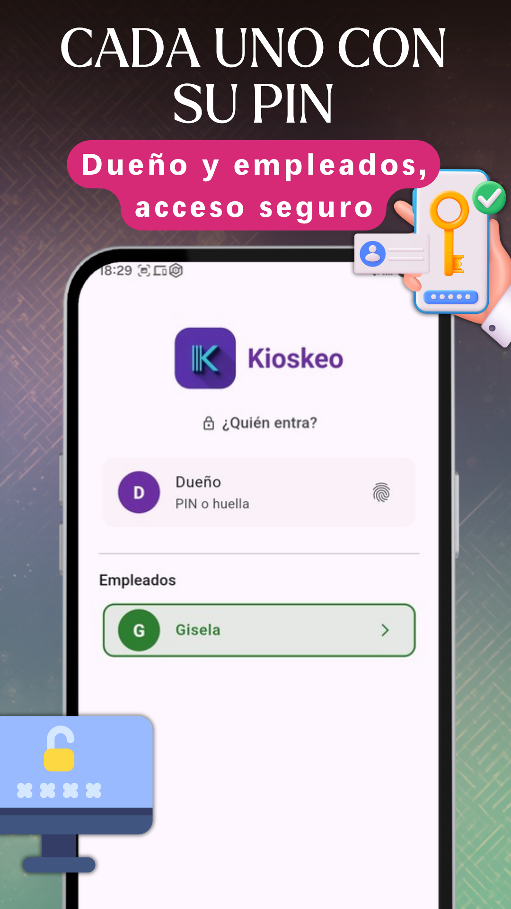

  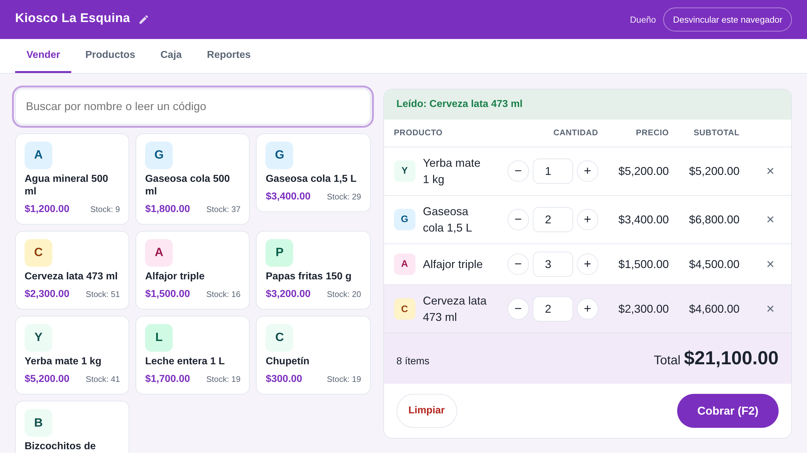
  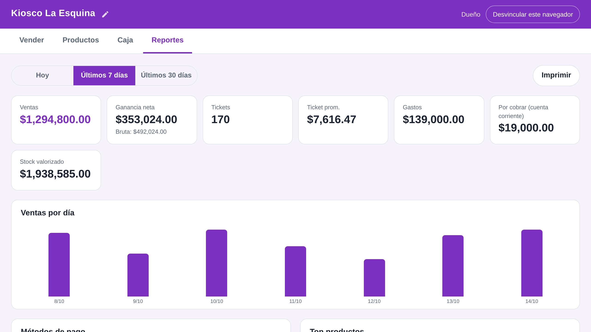

Screenshots of the Spanish version.

---

## 🛠️ FEATURES

### ⚡ Fast checkout
- Tap the product, charge and done. Or scan the barcode with the camera.
- Favorites for your best sellers, and a beep on scan like a supermarket register.
- Cash, bank transfer, card or store credit, with a change calculator.
- Discounts with a reason, and double confirmation above a threshold.

### 💻 On the computer
- Open Kioskeo in the browser of a computer on your Wi-Fi, nothing to install.
- Your phone scans the barcodes and each product shows up on the computer instantly.
- Cart, products, register and reports on a big screen.
- With PRO, sell, charge and edit from the computer, USB scanner included.

### 📦 Products
- Start with 716 typical convenience store products, with barcodes and reference prices.
- Add them by hand, by scanning, from CSV/Excel or by reading your supplier's PDF, with a preview.
- Photos, minimum stock, cost and selling price; categories with color and icon.
- Bulk price updates (% or fixed amount, by category or all).

### 🗃️ Cash drawer
- Open with starting cash and close comparing expected vs counted.
- Daily expenses and history broken down by payment method.
- Closings as PDF to share.

### 👥 Customers and store credit
- Customers with a balance, credit sales and partial or full payments.
- Transaction history per customer.

### 📊 Summary and reports
- Revenue, profit and top products in real time.
- Daily, weekly and monthly reports, with charts.

### 🔒 Security and employees
- Owner PIN and fingerprint; auto-lock after inactivity.
- Employees with PIN and custom permissions: every sale is signed.
- Log of voids, discounts and stock changes.

### ☁️ Backups
- Automatic backup every 24 hours; the last 10 are kept.
- Export via WhatsApp, Drive or Gmail.

### 🎨 Your way
- Light, dark or automatic theme.
- English, Spanish and Portuguese.
- Choose your currency: USD, EUR, ARS, BRL, MXN, CLP, UYU and more.

---

## 💎 FREE, AND PRO WITHOUT ADS

Every phone feature is free, with no limits. The free version shows a small ad, never while you charge.

If you'd rather not see ads, **Kioskeo PRO** removes them from the whole app and adds: selling, charging and editing from the computer; printing receipts, closings and reports from the computer; your kiosk's name up top; and priority support. Monthly, annual or one-time plan, with a 7-day free trial.

---

## ✅ WHY KIOSKEO

- Works 100% offline: if the internet goes down, you keep selling.
- Your data is yours: everything is stored on your phone, with no account and no EgeaINC servers. See the [privacy policy](PRIVACY_POLICY.md).
- No per-sale fees.
- Built in Argentina and tested in real shops.

---

## 💬 Feedback and support

This repository is where the community can send **feedback, report bugs and suggest improvements** for Kioskeo.

Found a bug or have an idea for the app?
👉 **[Open an issue here](https://github.com/gabriel600r/kioskeo-feedback/issues)**

---

  <b>EgeaINC</b> · Made with 💜 in Argentina 🇦🇷

